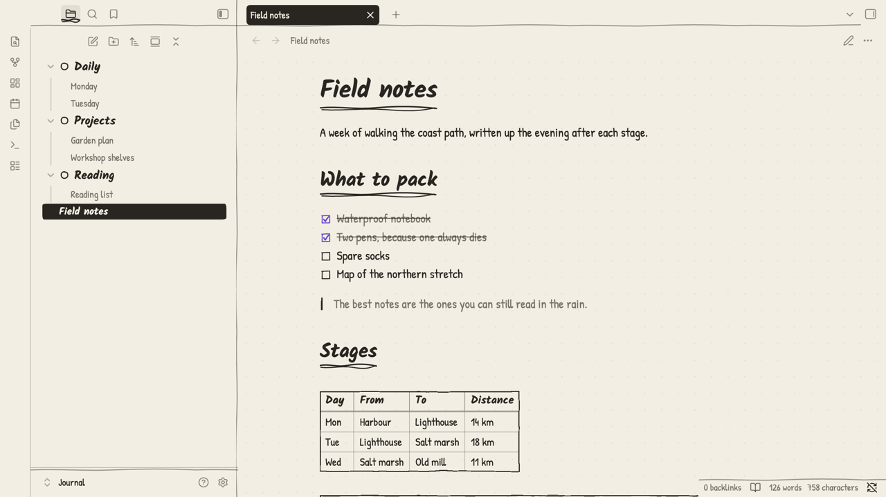
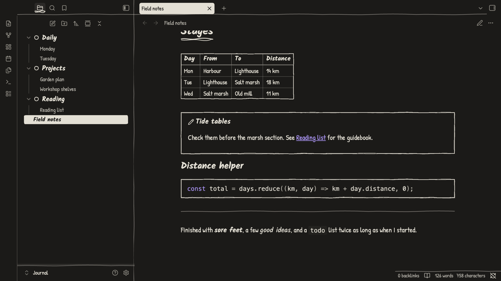

# Ink Journal

A pen-on-paper theme for Obsidian: handwriting fonts, wobbly ink outlines and scribbled heading rules, in light and dark. Two values, ink and paper, plus one pen colour for what's active or done.





## Install

**From Obsidian:** Settings → Appearance → Themes → Manage, search for **Ink Journal**, then Install and use.

**By hand:** download `manifest.json` and `theme.css` from the [latest release](https://github.com/XyndoX/obsidian-ink-journal/releases/latest) into `<vault>/.obsidian/themes/Ink Journal/`, then pick **Ink Journal** under Settings → Appearance → Themes.

Leave the text, interface and monospace font settings empty, because they override the theme's handwriting fonts.

## Plugin support

The theme also styles many community plugins, including Dataview, Tasks, Kanban, Calendar, Excalidraw, Notebook Navigator and Make.md. Plugins it doesn't cover keep working and use the theme's colours where they rely on Obsidian's variables.

## Note helpers

- `cssclasses: dashboard` lays a note out as outlined cards.
- `cssclasses: daily` centres headings and, combined with a weekday class such as `monday`, adds a tally mark.
- Top-level folders with a numbered prefix (`000 `, `200 ` to `900 ` in hundreds, `999 `) get their own hand-drawn glyph in the file list.

## Build from source

`theme.css` is generated, so edit the parts instead:

| File | Contents |
|---|---|
| `theme.src.css` | tokens (`--jr-*`), editor and core UI |
| `plugins-nav.css` | workspace, navigation and toolbar plugins |
| `plugins-content.css` | note content and view plugins |
| `snippets.css` | note helpers |
| `fonts.css` | embedded fonts |

```sh
./build.sh                                # writes theme.css
JOURNAL_VAULT=/path/to/vault ./build.sh   # also installs into that vault
```

## License

The theme is under the [MIT License](./LICENSE). It embeds [Kalam](./fonts/OFL-Kalam.txt) and [Patrick Hand](./fonts/OFL-PatrickHand.txt), both under the SIL Open Font License 1.1.
